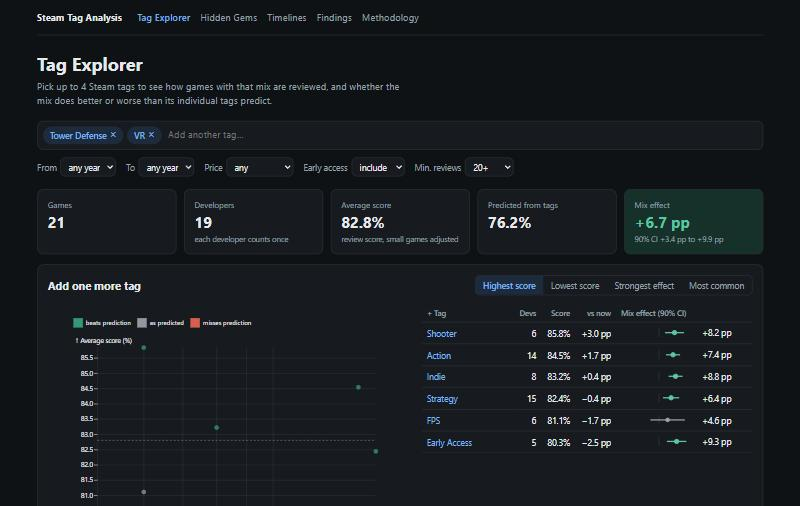
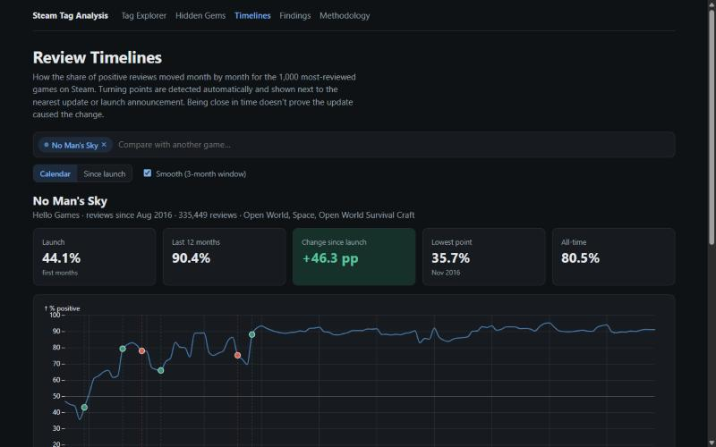

# Steam Tag Analysis

**Which genre mixes beat expectations on Steam, and how does a game's reception change after launch?**

An end-to-end data project: a resumable Python scraper for ~200k Steam apps, a statistical model of 60k reviewed
games and 120M reviews, and a static website that queries the results in the browser.

> **Live site: https://lucastyph.github.io/SteamTagAnalysis/**
> · [Tag Explorer](https://lucastyph.github.io/SteamTagAnalysis/#/explore?tags=Tower%20Defense,VR)
> · [Review Timelines](https://lucastyph.github.io/SteamTagAnalysis/#/timelines?games=275850)
> · [New Releases](https://lucastyph.github.io/SteamTagAnalysis/#/releases)
> · [Findings](https://lucastyph.github.io/SteamTagAnalysis/#/findings)
> · [Methodology](https://lucastyph.github.io/SteamTagAnalysis/#/methodology)

| Tag Explorer | Review Timelines |
|---|---|
|  |  |

## Highlights

- **Mix effects, done carefully.** Each game's score is an empirical-Bayes estimate. A ridge model predicts it from
  its tags, and a tag mix's *effect* is how far its games beat that prediction. Statistics are **clustered by
  developer**: one studio's 30 near-identical games once topped the rankings, so each developer now counts once.
  Rankings use 90% CIs with Benjamini–Hochberg false-discovery control.
- **Turning points in 1,000 review histories.** PELT change-point detection on monthly review scores, matched to the
  nearest developer update. It recovers No Man's Sky's comeback patch by patch, Cyberpunk 2077's recovery, and
  publisher-wide review bombs.
- **Pausable data collection.** Every fetch stage is a persistent job queue in SQLite; results and "done" flags
  are written in one transaction, so a run can be stopped at any moment (Ctrl+C, `--budget 30m`, power loss) and
  resumed with no lost or duplicated work.
- **No backend.** The site ships ~15 MB of Parquet/JSON and runs live, developer-clustered SQL in the browser with
  DuckDB-WASM. It works on GitHub Pages and moves to any host by changing one setting (`VITE_BASE`).

## Architecture

```
 Steam store APIs ──► fetch (rate-limited, resumable job queue) ──► SQLite raw cache
                                                                         │
                                       stp build ──► DuckDB tables ◄─────┘
                                                        │
                       stp analyze ──► scores · ridge model · combo effects · timelines
                                                        │
                       stp export  ──► web/public/data/*.parquet|json
                                                        │
            web/ (Vite + React + TS) ──► DuckDB-WASM + Observable Plot ──► GitHub Pages
```

```
pipeline/
  fetch/      client (rate limits, retries), job queue, run control, one module per endpoint
  build/      raw JSON → clean tables (games, tags, developers, monthly reviews, news)
  analysis/   shrinkage, ridge baseline, combo statistics, timeline metrics + change points
  export/     website data files and findings.json
web/src/      pages, components, DuckDB-WASM data layer
notebooks/    01 tag exploration · 02 combo effects review · 03 timeline validation
tests/        pytest: queue/resume, parsers, statistics on synthetic data with planted effects
```

## Running it

```bash
python -m venv .venv && .venv/Scripts/activate      # or: source .venv/bin/activate
pip install -e ".[analysis,notebook,dev]"
cp .env.example .env                                  # add a free Steam Web API key
```

```bash
stp fetch all --budget 30m      # app list → tag list → store details → developers (resumable)
stp fetch timelines             # review history + announcements for the top 1,000 games
stp status                      # progress per stage
stp build && stp analyze && stp export
```

Any fetch can be stopped and resumed by running the same command again. Useful extras:
`--retry-failed`, `--stale-after 30d` (refresh old data), `stp probe items-batch` (measure endpoint limits).

```bash
cd web && npm install && npm run dev                  # site at http://localhost:5173
```

Tests and lint: `ruff check . && pytest` and `cd web && npm run build`. CI runs both on every push, and pushes to
`main` deploy the site to GitHub Pages.

## Release tracking

A scheduled workflow ([track.yml](.github/workflows/track.yml)) runs every day and follows **every newly released
Steam game for its first year**. It finds new store pages, watches coming-soon games for their release, snapshots
each tracked game's review totals, and keeps exact positive and negative counts per day. Data goes to the
[`tracking-data`](../../tree/tracking-data) branch as plain CSV. The [New Releases](https://lucastyph.github.io/SteamTagAnalysis/#/releases)
page is rebuilt from it after every run.

```bash
stp track seed --dir tracking-data    # one-time: start from the local cache
stp track daily --dir tracking-data   # what the workflow runs each day
stp track status --dir tracking-data
```

## Caveats

Scores use Steam's filtered review counts; tags are today's tags; delisted games are missing; mix effects are
conservative (lower bounds) and correlational; a turning point's "nearest announcement" shows proximity, not cause.
Details on the [methodology page](https://lucastyph.github.io/SteamTagAnalysis/#/methodology). Not affiliated with Valve.

See [PLAN.md](PLAN.md) for the original design and milestones.
